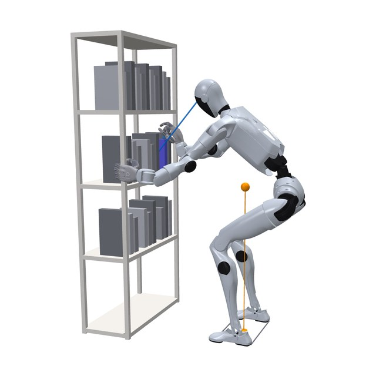
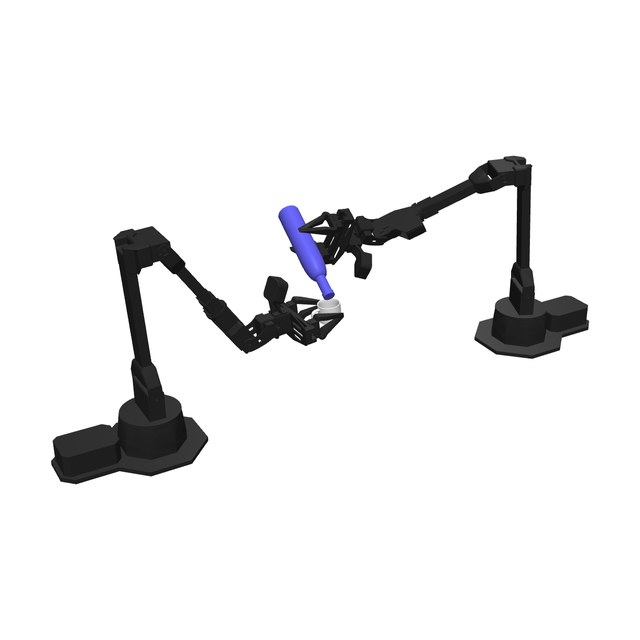
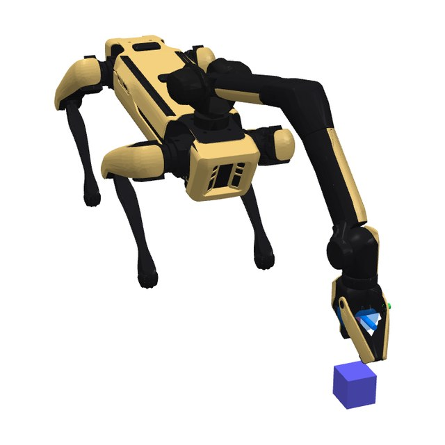
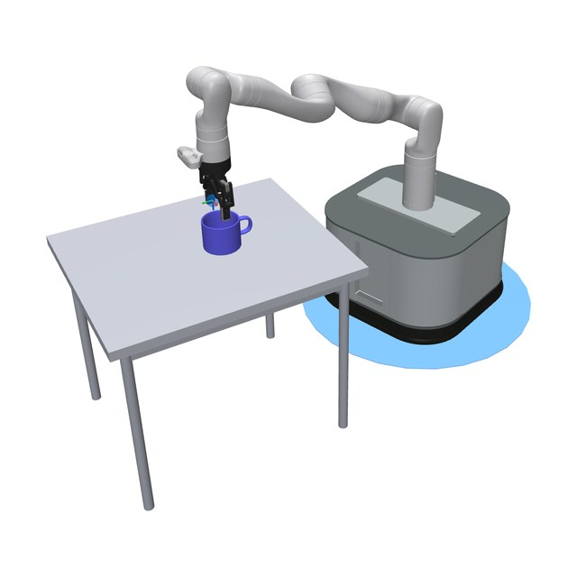
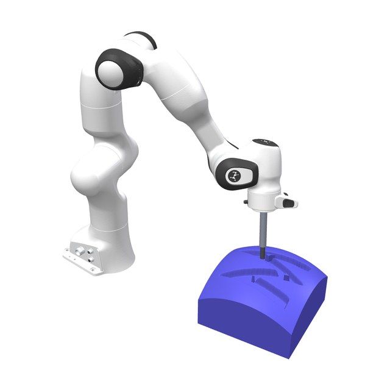
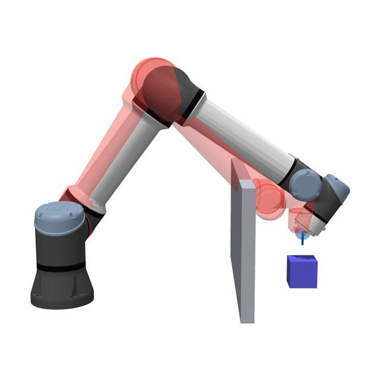

# mink

[](https://github.com/kevinzakka/mink/actions)
[](https://coveralls.io/github/kevinzakka/mink?branch=main)
[](https://pypi.org/project/mink/)
[](https://pypistats.org/packages/mink)

mink is a Python library for differential inverse kinematics, built on [MuJoCo](https://github.com/google-deepmind/mujoco).

You give mink **tasks** (objectives, such as a target pose for a frame), **limits** (inequalities, such as a joint range), and **constraints** (equalities that must hold, such as a foot that stays flat on the floor). At each step, mink solves a quadratic program for a velocity: the one that best reduces the task errors while it satisfies every limit and constraint. Integrate it over a short time step to get the next configuration, and repeat to move the robot toward the goal. mink works with any MuJoCo model, from a single arm to a humanoid with a floating base.

<table>
  <tr>
    <td align="center" width="33%"><a href="https://github.com/kevinzakka/mink/blob/main/examples/arm_ur5e_wrist_cam_lookat.py"></a><br><b>Unitree H2 + Sharpa</b><br><sub>whole body and fingers</sub></td>
    <td align="center" width="33%"><a href="https://github.com/kevinzakka/mink/blob/main/examples/arm_aloha.py"></a><br><b>ALOHA 2</b><br><sub>pouring with two hand tasks</sub></td>
    <td align="center" width="33%"><a href="https://github.com/kevinzakka/mink/blob/main/examples/quadruped_spot.py"></a><br><b>Spot</b><br><sub>pick from the ground</sub></td>
  </tr>
  <tr>
    <td align="center"><a href="https://github.com/kevinzakka/mink/blob/main/examples/mobile_tidybot.py"></a><br><b>TidyBot</b><br><sub>base task and arm task</sub></td>
    <td align="center"><a href="https://github.com/kevinzakka/mink/blob/main/examples/arm_panda_engrave.py"></a><br><b>Franka Panda</b><br><sub>axis alignment</sub></td>
    <td align="center"><a href="https://github.com/kevinzakka/mink/blob/main/examples/arm_ur5e.py"></a><br><b>UR5e</b><br><sub>collision avoidance (red: without it)</sub></td>
  </tr>
</table>

<sub>The images show staged scenes. Each image links to a related example.</sub>

## Installation

```bash
uv add mink
```

## Quickstart

This example moves the Panda hand 20 cm forward (+x) and 20 cm down. A posture task keeps the arm near its home configuration.

```python
import mujoco
import numpy as np
import mink
from robot_descriptions import panda_mj_description

model = mujoco.MjModel.from_xml_path(panda_mj_description.MJCF_PATH)
configuration = mink.Configuration(model)
configuration.update_from_keyframe("home")

hand = mink.FrameTask("hand", "body", position_cost=1.0, orientation_cost=1.0)
start = configuration.get_transform_frame_to_world("hand", "body")
hand.set_target(mink.SE3.from_translation(np.array([0.2, 0.0, -0.2])) @ start)

posture = mink.PostureTask(model, cost=1e-2)
posture.set_target_from_configuration(configuration)

dt = 0.01
for _ in range(200):
    vel = mink.solve_ik(configuration, [hand, posture], dt, "daqp")
    configuration.integrate_inplace(vel, dt)
```

Each loop iteration is one step: `solve_ik` returns a velocity, and `integrate_inplace` integrates it over `dt` to update the configuration.

You can also pass a task as a constraint. A hard constraint must hold exactly. If the problem has no feasible solution, `solve_ik` raises `NoSolutionFound`. An `Elastic` constraint replaces the equality with an L1 penalty. It holds exactly while the penalty is large enough and otherwise yields, so the problem stays feasible.

```python
vel = mink.solve_ik(
    configuration, [posture], dt, "daqp",
    constraints=[mink.Elastic(hand, penalty=1e3)],
)
```

The [documentation](https://kevinzakka.github.io/mink/) explains tasks, limits, and the underlying formulation.

## Features

**Tasks.** mink minimizes the task errors in a weighted least-squares sense.

* Pose of a frame, in the world or relative to a different frame (`FrameTask`, `RelativeFrameTask`)
* Center of mass (`ComTask`) and joint posture (`PostureTask`)
* Direction of a frame axis, toward a point or along a vector (`LookAtTask`, `AxisAlignTask`)
* Closed kinematic chains, from MuJoCo [equality constraints](https://mujoco.readthedocs.io/en/stable/computation/index.html#coequality) (`EqualityConstraintTask`)
* Regularization and DOF freezing (`DampingTask`, `KineticEnergyRegularizationTask`, `DofFreezingTask`)

**Limits.** mink applies limits as inequalities.

* Joint position and velocity limits (`ConfigurationLimit`, `VelocityLimit`)
* Velocity limits on a floating base (`FreeJointVelocityLimit`)
* Collision avoidance between pairs of geoms (`CollisionAvoidanceLimit`)

**Constraints.** mink applies constraints as equalities.

* A task held exactly (hard constraint)
* A task wrapped in `Elastic`, which yields through an L1 penalty instead of making the problem infeasible

Frame transforms and the errors and Jacobians of frame tasks use native C code.

## Examples

To run an example:

```bash
git clone https://github.com/kevinzakka/mink.git && cd mink
uv sync

uv run examples/arm_ur5e.py           # Linux
./fix_mjpython_macos.sh               # macOS, once
uv run mjpython examples/arm_ur5e.py  # macOS
```

More examples:

* **Elastic constraints**: three Pandas follow a target that they cannot reach, using a task, a hard constraint, and an `Elastic` constraint ([arm_panda_elastic.py](https://github.com/kevinzakka/mink/blob/main/examples/arm_panda_elastic.py))
* **Look-at**: a UR5e points a wrist camera at a moving target ([arm_ur5e_wrist_cam_lookat.py](https://github.com/kevinzakka/mink/blob/main/examples/arm_ur5e_wrist_cam_lookat.py))
* **Closed chains**: `EqualityConstraintTask` models the leg linkages of Agility Cassie, which MuJoCo defines as equality constraints ([biped_cassie.py](https://github.com/kevinzakka/mink/blob/main/examples/biped_cassie.py))
* **DOF freezing**: `DofFreezingTask`, passed as a constraint, holds a subset of the joints fixed ([arm_panda_dof_freezing.py](https://github.com/kevinzakka/mink/blob/main/examples/arm_panda_dof_freezing.py))
* **Actuators**: a simulated UR5e receives each IK configuration as position actuator targets ([arm_ur5e_actuators.py](https://github.com/kevinzakka/mink/blob/main/examples/arm_ur5e_actuators.py))
* **Dual arms**: [Dual Panda](https://github.com/kevinzakka/mink/blob/main/examples/arm_dual_panda.py), [Dual iiwa14](https://github.com/kevinzakka/mink/blob/main/examples/arm_dual_iiwa.py), [Flying Dual UR5e](https://github.com/kevinzakka/mink/blob/main/examples/arm_dual_flying_ur5e.py)
* **More robots**: [Unitree G1](https://github.com/kevinzakka/mink/blob/main/examples/humanoid_g1.py), [Shadow Hand](https://github.com/kevinzakka/mink/blob/main/examples/hand_shadow.py), [iiwa14 + Allegro](https://github.com/kevinzakka/mink/blob/main/examples/arm_hand_iiwa_allegro.py), [Franka Panda](https://github.com/kevinzakka/mink/blob/main/examples/arm_panda.py), [KUKA iiwa14](https://github.com/kevinzakka/mink/blob/main/examples/arm_iiwa.py), [Apptronik Apollo](https://github.com/kevinzakka/mink/blob/main/examples/humanoid_apollo.py), [xArm7 + LEAP](https://github.com/kevinzakka/mink/blob/main/examples/arm_hand_xarm_leap.py), [Unitree Go1](https://github.com/kevinzakka/mink/blob/main/examples/quadruped_go1.py), [Hello Robot Stretch](https://github.com/kevinzakka/mink/blob/main/examples/mobile_stretch.py), [Kinova Gen3 + LEAP](https://github.com/kevinzakka/mink/blob/main/examples/mobile_kinova_leap.py)

## Citation

If you use mink in your research, cite it as follows:

```bibtex
@software{Zakka_Mink_Python_inverse_2026,
  author = {Zakka, Kevin},
  title = {{Mink: Python inverse kinematics based on MuJoCo}},
  year = {2026},
  month = oct,
  version = {1.4.0},
  url = {https://github.com/kevinzakka/mink},
  license = {Apache-2.0}
}
```

## Contributing

Report bugs in the [issue tracker](https://github.com/kevinzakka/mink/issues). To submit a pull request, read the [contributing guidelines](CONTRIBUTING.md).

## Acknowledgements

mink is a direct port of [Pink](https://github.com/stephane-caron/pink), which is built on [Pinocchio](https://github.com/stack-of-tasks/pinocchio). Stéphane Caron, the author of Pink, is a role model for open-source software in robotics. This library would not have been possible without his work and assistance throughout this project.

mink also adapts code from these libraries:

* The Lie group code for the transforms comes from [jaxlie](https://github.com/brentyi/jaxlie).
* The collision avoidance limit comes from the LSQP controller in [dm_robotics](https://github.com/google-deepmind/dm_robotics/tree/main/cpp/controllers).

## References

The Lie group code refers to numbered equations in _[A micro Lie theory for state estimation in robotics](https://arxiv.org/abs/1812.01537)_, Joan Solà, Jérémie Deray, and Dinesh Atchuthan, arXiv:1812.01537 (2018).
